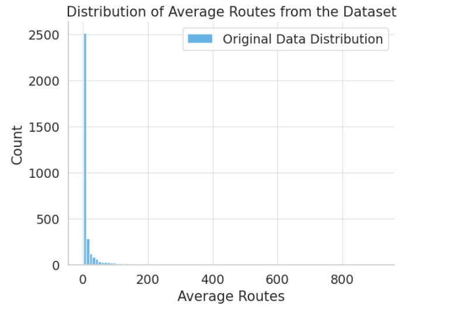
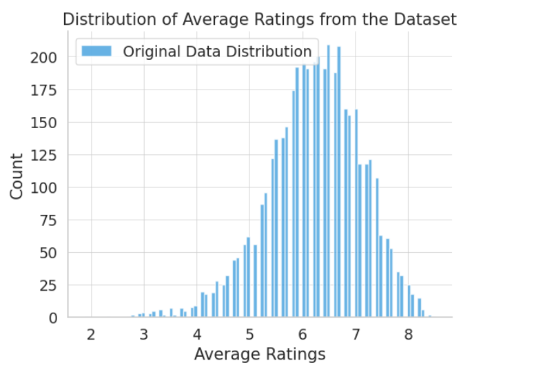
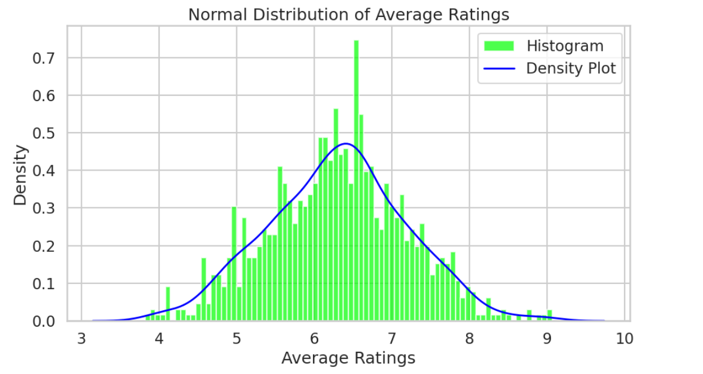

# Airport, Movie & Birth-Data Analysis in Python


Exploratory data analysis in Python (pandas, NumPy, Matplotlib, Seaborn, SciPy) that fits
candidate probability distributions to three real datasets and compares them against the
observed data. The question in each case: which distribution actually describes the data?

## Key Results

| Dataset | Best-fitting distribution | Headline numbers |
|---|---|---|
| Airport routes (3,409 airports) | **Power law** | α = 1.612; mean 19.85 routes, max 915 (ATL) |
| Movie ratings | **Normal** | μ = 6.227, σ = 0.893; ratings span 1.9–8.5 |
| Ages from birth dates (ages 1–99) | **Normal** for ages and their first digit; **uniform** for the last digit | Last digit spread evenly across 0–9 |

- **Airport routes follow a power law** — most airports serve only a handful of routes while
  a few hubs serve hundreds: the classic hub-and-spoke pattern.
- **Movie ratings follow a normal distribution** — most movies sit near the mean rating of
  ~6.2, with fewer at the extremes.
- **Ages are bell-shaped, but their last digit is flat** — ages and their first digits bunch
  around the middle, while the last digit is spread evenly across 0–9, as expected for a
  roughly normal age distribution.

## Datasets

| Dataset | File | Rows | What it measures |
|---|---|---|---|
| Airport routes | `data/airport_routes.csv` | 3,409 airports | Number of routes per airport (`Airport`, `NumberOfRoutes`) |
| Movie ratings | `movie_votes.csv` *(not in repo yet)* | — | Average vote per movie (`AverageVote`) |
| Birth dates | `DoB.txt` *(not in repo yet)* | — | Dates of birth, used to derive ages 1–99 |

> `movie_votes.csv` and `DoB.txt` are not included yet — the notebooks reference them from
> their original locations. They will be added to `data/` when available.

## Findings

### Airport routes — a power law

Most airports serve only a handful of routes while a few hubs serve hundreds, so the
distribution is heavily right-skewed. Fitted parameters:

| Distribution | Parameter |
|---|---|
| Power law | α = 1.612 |
| Exponential | λ = 0.0504 |
| Uniform | [a, b] = [1, 915] |
| Normal | μ = 19.85, σ = 53.51 |



*Observed routes per airport across 3,409 airports — a steep drop from a few routes to a
long tail reaching 915, the shape a power law describes.*

**Conclusion: the route counts follow a power-law distribution** — the classic hub-and-spoke
pattern, where a small number of airports carry most of the traffic.

### Movie ratings — a normal distribution

Average votes cluster around the middle of the scale with symmetric spread. Fitted parameters:

| Distribution | Parameter |
|---|---|
| Power law | α = 1.851 |
| Exponential | λ = 0.1606 |
| Uniform | [a, b] = [1.9, 8.5] |
| Normal | μ = 6.227, σ = 0.893 |



*Average movie ratings form a bell shape centred near 6.2.*



*The fitted normal curve (μ = 6.227, σ = 0.893) over the observed rating histogram.*

**Conclusion: the ratings follow a normal distribution** — most movies sit near the mean
rating of ~6.2, with fewer at the extremes.

### Birth dates — ages, first digits, last digits

Dates of birth are converted to ages (kept in the 1–99 range), then the first and last
digits of each age are examined separately:

| Series | Distribution |
|---|---|
| Ages | Normal |
| First digit of age | Normal |
| Last digit of age | Uniform |

The last digit is spread evenly across 0–9, while the ages themselves and their first
digits bunch around the middle — as expected when ages are roughly bell-shaped.

## Methods

Each dataset was fitted with the same four candidate distributions — power law,
exponential, uniform, and normal — using SciPy, and the fits were compared against the
observed data visually (histograms, density plots, and fitted-distribution overlays) to
judge which candidate actually describes the data.

## Notebooks

| Notebook | Contents |
|---|---|
| Airport routes analysis | Summary statistics, power-law / exponential / uniform / normal fits, and a visual comparison of the observed data against the fitted power law |
| Movie ratings analysis | Summary statistics, the same four distribution fits, and a comparison of the observed ratings against the fitted normal |
| Birth-date analysis | Age calculation, 1–99 filtering, first/last digit extraction, and histograms of the age, first-digit, and last-digit distributions |

The notebooks were developed in Google Colab (`pandas`, `numpy`, `matplotlib`, `seaborn`,
`scipy`). The polished versions are the main ones; earlier drafts of the movie and
birth-date analyses are kept in `notebooks/` for reference.

## Project layout

```
├── README.md
├── LICENSE
├── data/
│   └── airport_routes.csv      # routes per airport (3,409 rows)
├── images/
│   ├── airport-route-distribution.png
│   ├── movie-rating-distribution.png
│   └── movie-rating-normal-fit.png
├── notebooks/                  # airport, movie, and birth-date analyses
└── report/
    └── Data_Analysis_Report.pdf
```

## How to Run

```bash
pip install pandas numpy matplotlib seaborn scipy
jupyter notebook
```

Then open the airport-routes notebook in `notebooks/` — it runs as-is with the bundled
`data/airport_routes.csv`. The movie and birth-date notebooks expect `movie_votes.csv` and
`DoB.txt` — update the file paths at the top of each notebook to point at your local copies.

## License

MIT — see [LICENSE](LICENSE).
